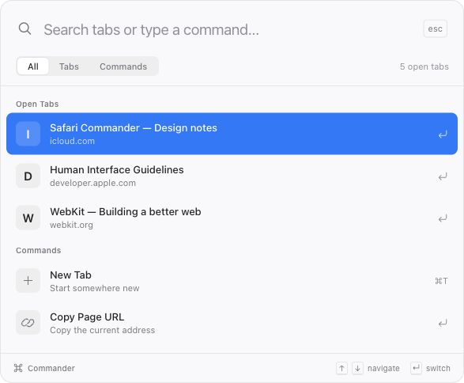

# Safari Commander

A quiet command palette for Safari on Mac. Press **⌘K**, type a few letters, and keep moving.

<picture>
  <source media="(prefers-color-scheme: dark)" srcset="docs/palette-dark.png">
  
</picture>

*Design preview with sample tabs.*

## What’s here

- Fuzzy search across open tabs in your current Safari profile and browsing session, including other windows.
- Switch tabs and focus their window. Recently used tabs appear first after Commander has observed them.
- Open an HTTP(S) address or search the web in a new tab.
- New tab/window, copy page URL, reload, duplicate, mute/unmute, and close tab.
- A centered webpage palette on **⌘K**, plus a toolbar popup for Start Page, restricted pages, or websites without access.
- System fonts, light/dark appearance, standard blue selection, reduced-motion/transparency support, and an accessible keyboard-operated list.

The first version is intentionally local and small. No accounts, analytics, third-party JavaScript, remote favicon requests, or build dependencies. Web searches use **DuckDuckGo**; extensions cannot read Safari’s selected default search engine. Site searches support `yt cats`, `gh swift`, and `w webkit`.

## Try it in Safari

The fastest route on Safari versions that offer **Add Temporary Extension…** (including Safari 27 on macOS 27):

1. Open **Safari → Settings → Advanced** and enable **Show features for web developers**, if the Developer tab is hidden.
2. Go to **Developer → Add Temporary Extension…**. Safari asks you to allow unsigned extensions for local development. Complete that prompt yourself.
3. Select this repository’s **`extension` folder** or **`build/Safari-Commander-extension.zip`**. The ZIP can be generated with `npm run package`; the folder works directly, with no build step.
4. In **Extensions → Safari Commander**, enable the extension. Allow website access on the sites you want to search and use the overlay on. Access to all desired sites is needed for their tab titles and URLs to be available.
5. Open an ordinary webpage and press **⌘K**. You can also use the **⌘ toolbar button**. If Safari has another shortcut assigned, set **Show Safari Commander** to **⌘K** in the extension’s settings.

Safari removes temporary extensions when you quit Safari or after 24 hours. Use **Reload** beside the extension in Safari Settings after editing the source.

Apple’s instructions: [Running your Safari web extension](https://developer.apple.com/documentation/safariservices/running-your-safari-web-extension).

### Mac app / Xcode route

This repository also includes a macOS containing app and Safari extension. Xcode and its command-line tools are required.

```sh
npm run build:mac
open 'build/DerivedData/Build/Products/Debug/Safari Commander.app'
```

The app provides a button to open Safari’s extension settings. The local build uses ad-hoc signing, so Safari still requires **Allow unsigned extensions** for development. This is a developer build, not a notarized public installer. A Developer ID/App Store signing setup is needed for distribution without development settings.

To configure signing yourself, open `macos/Safari Commander/Safari Commander.xcodeproj`, select your team for the app and extension targets, and run the **Safari Commander** scheme. The project references `extension/` directly; there is one source of truth for the web extension.

## Keys

| Key | Action |
| --- | --- |
| ⌘K | Show or hide the centered palette |
| ↑ / ↓ | Select a result |
| Return | Switch, open, or run |
| ⌘Return | Open a matching tab’s address in another tab |
| Escape | Dismiss and restore focus |
| Control-Tab / Control-Shift-Tab | Cycle All / Tabs / Commands |
| `> query` | Search commands only |
| `@ query` | Search open tabs only |

The suggested **⌘K** shortcut is registered through Safari’s commands API. Safari owns shortcut routing and customization; Commander does not install a global keyboard listener or override website shortcuts with a page-level key handler.

## Privacy and permissions

- **Tabs:** list and switch open tabs. Safari may omit titles/URLs for websites without permission.
- **Website access + scripting:** display the centered palette when requested. The script runs on demand, isolates its UI in a closed shadow root, and restores the prior focused element when dismissed. It does not scrape page text or forms.
- **Clipboard write:** copy the current page address when you select that command.
- **Session storage:** recent activation timestamps and short-lived overlay connection tokens. These are not synced or stored as browsing history.
- Private and regular windows are kept separate. Safari decides whether the extension is enabled for private browsing and for each profile. Commander does not bypass those controls.

Only explicit navigation/search actions contact the destination website or search provider. Tab titles and URLs are rendered as plain text. The overlay authenticates its extension frame before accepting requests.

## Scope and limitations

This is an early **macOS Safari** build. The development target is Safari 26+; the packaged app has been compiled with Xcode 27.1. Local model/background checks and browser-preview interaction checks pass. Full Safari shortcut, overlay, clipboard, and popup-fallback testing requires enabling the extension locally and remains part of the first manual test.

- Safari’s native address bar, tab strip, and sidebar are not replaced.
- History, bookmarks, closed-tab restoration, tab-group management, and profile switching are outside this version.
- The popup fallback depends on Safari allowing `action.openPopup()` for the shortcut gesture. If a page prevents the centered palette or fallback from opening, use the toolbar button.
- Safari may restrict scripts on PDFs, internal pages, or sites with strict embedding rules. Website permissions control where the overlay can run.
- Reduced transparency uses an opaque palette. The frosted backdrop is a web effect; this extension does not draw a native AppKit vibrancy panel.

## Development

No dependency installation is needed. Node 20+ is used for the local tools and checks; Python 3 packages the ZIP. The extension itself is plain JavaScript, HTML, and CSS.

```sh
npm run preview    # http://127.0.0.1:4173 — sample tabs, simulated actions
npm run check      # syntax, manifest resources, default shortcut
npm test           # search, navigation, private-session and message-handling checks
npm run check:webkit # WebKit manifest and shortcut validation (macOS 15.4+, Xcode)
npm run package    # build/Safari-Commander-extension.zip
npm run build:mac  # local ad-hoc signed macOS app
```

Preview URLs accept `?theme=light` or `?theme=dark`. Preview data is injected by the local server and is not shipped in the extension. No CI configuration is included.

`swift scripts/make-icons.swift` regenerates the extension’s app and toolbar icons using AppKit. The app’s matching icon assets are checked in.

See [the manual test checklist](docs/TESTING.md) before distributing a release.

## License

[MIT](LICENSE)
